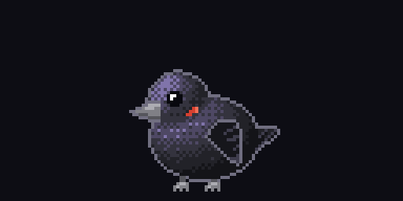
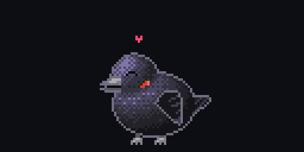
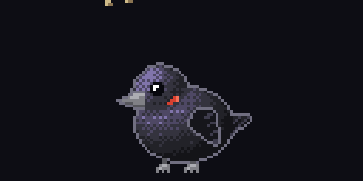
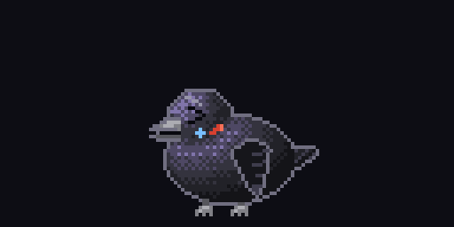
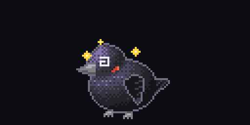
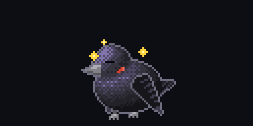
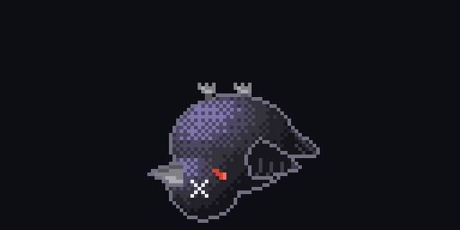
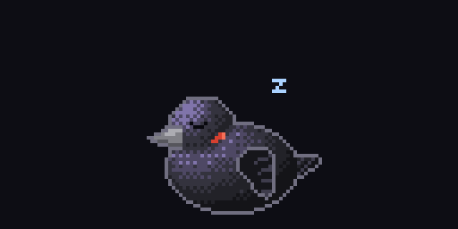
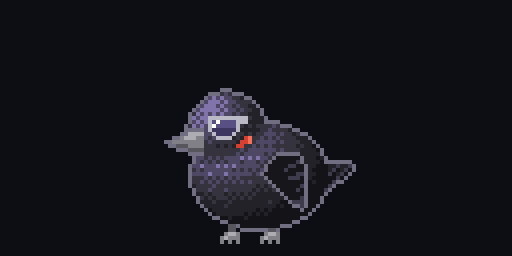
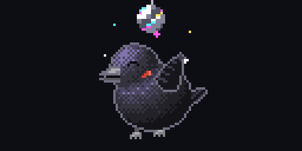

# Raven Pet 🐦‍⬛: a tamagotchi raven for Raven Prism



A fat, pixel-art raven (modelled on the Raven plush) lives in the corner of your **Raven Prism**
glasses and reacts to how you use your **phone**. Doomscroll and it gets hurt. Answer email, go
for a walk or put the phone down and it thrives. Look at it and it showers you with hearts.

**🎬 Demo video: https://youtu.be/6lmOFtocQfU**

[](https://youtu.be/6lmOFtocQfU)

> **Status:** a ~30-minute hackathon prototype. It works end to end on a real Pixel 9 and the
> Raven simulator, and we'd love to flesh it out (see [Roadmap](#roadmap)).

Every animation below is **procedural**: no sprite sheets. The raven, its shading, wings, eyes,
particles and the disco ball are all generated in code each frame
([`pixel_art.py`](raven_pet/pixel_art.py), [`animator.py`](raven_pet/animator.py)).
These GIFs are rendered straight from that code by
[`tools/make_gifs.py`](raven_pet/tools/make_gifs.py).

| | |
|---|---|
| **Happy** (health > 50%): hops around, flaps, blinks<br> | **Look at it**: happy eyes, bouncing, hearts<br> |
| **Fed** (email / Outlook / Canvas open): seeds rain down and it pecks them up<br> | **Hurt** (Instagram / TikTok / X / Facebook open): >_< face, tears, flinches with a red flash, loses feathers<br> |
| **Dizzy** (≤ 50% health): brain fog, spiral eyes, stars orbiting its head<br> | **Groggy** (≤ 25% health): trudges along dragging its wings, stars still spinning<br> |
| **Dead** (0% health): on its back, feet up, X eyes<br> | **Sleeping** (you're asleep, or energy is low): Z's float up<br> |
| **Sunglasses** (sunny outside / lenses tinted)<br> | **Disco** (every stat maxed): mirror ball, lights, dance party<br> |

---

## Features

**Four stats**, shown as a pixel HUD (icons, not just colours):

| Stat | Goes up when… | Goes down when… |
|---|---|---|
| ❤ **Health** | productive apps, sleep, walking, looking at the raven | doomscrolling; any other stat hitting 0 |
| 🍒 **Food** | Gmail / Outlook / email / Canvas are open (seeds!) | slowly over time |
| ⚡ **Energy** (tired) | phone screen off = resting; 30+ min screen-off = **sleep** (much faster) | using the phone, doomscrolling |
| 👣 **Play** | **walking** (phone step counter), Zoom calls, looking at the raven | slowly over time |

- **Penalty apps:** Instagram, TikTok, X, Facebook. While one is open the raven is visibly in pain, so you want to close the app.
- **Health stages:** happy above 50%, dizzy at 50% or below, groggy at 25% or below, dead at 0.
- **Revive:** spend 5 minutes in productive apps or walk 500 steps.
- **Eye interaction:** hold your gaze on the raven for about 0.6 s and it plays the hearts animation, which gives +play and +health.
- **Sunglasses:** the raven puts them on when your phone's light sensor reads sunlight (or the screen is at full brightness), and when the glasses' lenses are tinted (simulator "Tint" button).
- **Disco party** when health, food, energy and play are all at 95 or above.
- **Remembers everything:** state is saved, and time spent while the app was closed is caught up on the next launch.

## How it works

```
 Pixel phone (android/)                         Raven Prism glasses (raven_pet/)
 ┌──────────────────────────────┐   HTTP POST   ┌───────────────────────────────────┐
 │ foreground app (UsageStats)  │ ────────────▶ │ classify app → doom / feed / pet  │
 │ screen on/off (rest, sleep)  │  every 5 s +  │ tick stats (health/food/energy/   │
 │ step counter (play)          │  on change    │   play) → mood                    │
 │ light sensor + brightness    │ ◀──────────── │ animator → procedural pixel art   │
 │ (sunglasses)                 │  raven stats  │ gaze on raven → hearts            │
 └──────────────────────────────┘               └───────────────────────────────────┘
        finds the glasses via a UDP beacon (Wi-Fi) or adb reverse (USB)
```

### Eye-based interaction
Raven Prism tracks your eyes and gives apps a gaze point. In the simulator, the mouse stands in for it.
1. **Hit test.** Every frame (12 fps) the app checks whether the gaze point is inside a generous oval around the raven's body. Eye tracking is only accurate to about 2–3°, so the hit area is larger than the bird.
2. **Dwell.** The gaze has to stay on the raven for **0.6 s**. Glances don't count, because accidental gaze is common on glasses.
3. **Reaction.** The raven plays a 2.6 s love animation (happy eyes, bouncing, hearts) and wakes up if it was asleep.
4. **Reward.** +6 play and +1 health, at most once every 20 s, so you can't farm stats by staring.

There are no buttons. Looking at the raven *is* the interaction, and it lives in your lower periphery.

---

## How to use

### 1. Glasses app / simulator

```bash
python3 -m venv .venv
.venv/bin/pip install -e raven-framework-main/raven-framework-main
cd raven_pet
../.venv/bin/python main.py           # opens the Raven simulator
../.venv/bin/python main.py deploy    # deploy to real glasses (fill APP_ID / APP_KEY in main.py first)
```

**In the simulator:** the mouse is your gaze. Hover on the raven to get hearts.

**Keyboard shortcuts** (click the simulator window first):

| Key | Does | Key | Does |
|---|---|---|---|
| `1` | pretend Instagram is open (pain) | `W` | +250 steps (play) |
| `2` | pretend Gmail is open (seeds) | `L` | hearts now |
| `3` | pretend Zoom is open (pet) | `T` | toggle sunglasses |
| `4` | some other app | `M` | max all stats (disco) |
| `5` | phone screen off (rest) | `D` | −25 health (dizzy, then groggy, then dead) |
| `6` | phone asleep 30+ min (sleep) | `F` | 60× time speed |
| `0` | disconnect phone | `R` | reset the raven |

> ⚠ **Framework keys:** a single **Enter** quits the app. **Enter twice** puts the app to sleep (it fades out and looks crashed); press Enter twice again to wake it.
> The **Tint** button on the simulator's bottom bar makes the raven put on sunglasses.

### 2. Phone app (Android, tested on Pixel 9)

```bash
cd android
./gradlew assembleDebug          # JDK 17–21 + Android SDK (local.properties → sdk.dir)
adb install -r -g app/build/outputs/apk/debug/app-debug.apk
```

On the phone, open **Raven Pet**:
1. Tap **Grant usage access** and switch Raven Pet on. This is how the app sees which app is open.
2. Allow **step tracking** and **notifications**.
3. Tap **Start sending to Raven**. A notification shows the raven's stats.

**Connecting the phone to the glasses:**
- **Same Wi-Fi:** the glasses broadcast a beacon and the phone finds them automatically, or you can type in the IP the glasses show.
- **USB to the desktop simulator** (works on any network): run
  ```bash
  raven_pet/tools/usb_link.sh      # keeps `adb reverse tcp:8765 tcp:8765` alive
  ```
  then set the phone app's glasses address to `127.0.0.1` and tap **Save address**.

The phone app's screen shows exactly what's going on:
- the current app and what the glasses classified it as
- steps, brightness and light level
- the raven's stats

### 3. Demo script (about 60 seconds)
1. **Start:** the raven hops around happily. Hover on it (or look at it) to get hearts.
2. **Open Instagram:** the raven cries, flinches red and loses feathers, and health drops. Press `D` to skip ahead to dizzy stars, groggy wing-dragging, then dead.
3. **Open Gmail:** seeds rain down and it eats them. Walk around or press `W`, and play goes up. Press `M` for the disco party.
4. **Click Tint** in the simulator, or take the phone into the sun: sunglasses.

### Configuration
| Env var | Default | Meaning |
|---|---|---|
| `RAVEN_PET_SPEED` | `1` | time multiplier for demos |
| `RAVEN_PET_PORT` | `8765` | port the phone talks to |
| `RAVEN_PET_STATE` | `~/.local/share/raven_pet/state.json` | save file |
| `RAVEN_PET_PAIR` | (none) | optional code the phone must send as `X-Raven-Pair` |

To change which apps hurt, feed or pet the raven, create `raven_pet/categories.json`:
```json
{"doom": ["com.instagram.android"], "feed": ["com.google.android.gm"], "pet": ["us.zoom.videomeetings"]}
```

### Tests and tools
```bash
cd raven_pet
../.venv/bin/python -m pytest -q tests        # pet rules, steps, sleep, revive, animator
../.venv/bin/python tools/render_preview.py   # PNG contact sheet of every pose
../.venv/bin/python tools/make_gifs.py        # regenerate docs/gifs/*.gif
```

---

## Project layout
```
raven_pet/            Raven Prism app (Python + Raven Framework)
  main.py               entry point: UI, gaze, game loop, simulator keys
  pet_state.py          stats + rules + app categories + save/load (pure Python)
  animator.py           behaviour state machine → poses (pure Python)
  pixel_art.py          procedural raven, seeds, tears, feathers, sunglasses, disco ball
  phone_link.py         HTTP server for the phone + UDP discovery beacon
  tools/                previews, GIF renderer, USB link keep-alive
  tests/
android/              companion app (Kotlin, no third-party libraries)
docs/gifs/            rendered animations
art/                  reference photos of the Raven plush
```

### Phone → glasses protocol
`POST http://<glasses>:8765/activity`
```json
{"package": "com.instagram.android", "label": "Instagram", "screen_on": true,
 "steps_total": 12345, "brightness": 0.4, "lux": 160}
```
The response (also `GET /status`) is the raven's state:
```json
{"health": 72.0, "food": 80.1, "energy": 64.3, "play": 55.0, "mood": "happy",
 "activity": "doom", "sunglasses": false, "steps_today": 1200, "alive": true}
```

## Roadmap
- **Real lens-tint / ambient-light API** on the glasses for the sunglasses (the SDK has none yet; the simulator's Tint button is used).
- **Tune gaze dwell and hit area** on real hardware.
- **Sound:** chirps, squawks and a disco beat through the glasses' speakers.
- **Feeding the raven by voice,** using the glasses' microphones.
- **Daily summary:** screen-time saved, steps and the raven's mood history, plus streaks and accessories as rewards.
- **More app categories:** reading and fitness apps; browser-based doomscrolling (only apps are detected today).
- **iOS companion** (Screen Time API), and a secure pairing flow instead of plain LAN HTTP.

## Notes
- Raven Prism uses an **additive** display, where pure black is invisible. The "black" raven is charcoal with a light violet rim and sheen, so it stays visible.
- On Wi-Fi networks that isolate clients, or where the phone and glasses are on different subnets (common on campus Wi-Fi), discovery won't work. Use USB (`usb_link.sh`) or a hotspot.
- The Raven Framework in `raven-framework-main/` is proprietary to Raven Resonance and is included unmodified.
